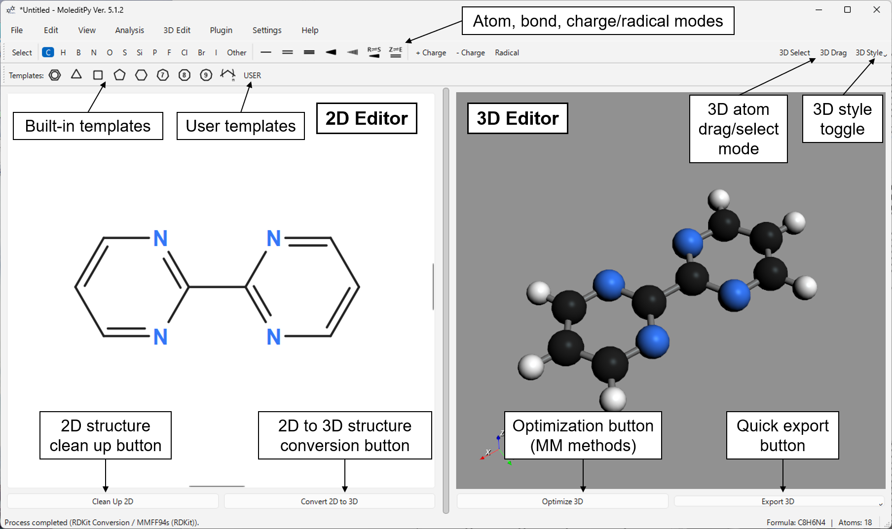

# Summary

**MoleditPy** is a cross-platform, lightweight molecular editing and visualization platform with a Python plugin API, designed to provide an interactive graphical interface for cheminformatics and computational chemistry workflows. It uses RDKit [@rdkit] for chemical graph intelligence and PyVista [@pyvista] for high-performance 3D rendering. MoleditPy is built on a "Simplicity at the Core, Limitless Potential in the Extensions" philosophy, providing a streamlined environment for 2D molecular sketching, button-triggered 2D-to-3D conversion and force-field optimization, and interactive geometry manipulation. The platform is designed primarily for the small-to-medium-sized organic molecules commonly studied by molecular chemists. Its capabilities can be extended through plugins; illustrative examples include input generators for ORCA [@orca] and Gaussian [@gaussian], a PySCF [@pyscf] in-app calculator, and results analysis tools.

# Statement of need

In modern computational chemistry, researchers often face a gap between powerful Python libraries (such as RDKit and PySCF) and interactive graphical tools. While traditional, standalone graphical editors offer rich interfaces, they are often difficult to customize or integrate directly into Python-centric workflows due to their heavyweight architectures, process isolation, or reliance on custom macro languages. A common pain point is the fragmented, file-based workflow: quickly sketching a simple organic molecule often requires switching to a heavy GUI application, exporting the structure to an intermediate file, and manually preparing it as an input file or loading it back into a script for downstream quantum chemical calculations.

MoleditPy bridges this gap by providing an agile environment for the rapid, interactive construction of organic molecular models. It serves as programmable "Pythonic glue" for the scientific stack, allowing researchers---particularly computational chemists and cheminformatics researchers---to transition smoothly from interactive 2D/3D molecular editing to input preparation for computational chemistry calculations, all within a unified, highly extensible Python ecosystem.

# State of the field

MoleditPy occupies a distinct niche by prioritizing a lightweight, Python-native footprint and strong extensibility. Established tools like Avogadro 2 [@avogadro; @avogadro2] use a robust C++ core and JSON-based inter-process communication (IPC)---an architecture that effectively supports language-agnostic scripting---but this design intentionally separates scripts from the application's internal memory. MoleditPy takes a different approach: by exposing its application layer in Python (on PySide6 and PyVista), it gives plugins unrestricted, direct access to the application's internal state. This enables deep customization for advanced users, while typical extensions remain implementable through well-defined plugin mechanisms. In contrast to tools like VMD [@vmd] and PyMOL [@pymol], which excel at large-scale molecular visualization, MoleditPy focuses on the interactive editing and state management of individual molecules and small systems, providing a more agile environment for early-stage molecular design and input preparation. Within the Python ecosystem, the ASE GUI [@ase] supports editing atomic configurations, including periodic systems and trajectories, but does not provide a native chemical-graph editing workflow with explicit bond orders and stereochemistry. Notebook viewers such as py3Dmol [@3dmol] primarily provide interactive molecular visualization rather than a dedicated molecular editing interface.

# Software design

As shown in \autoref{fig:1}, MoleditPy provides:

1. **Interactive 2D Sketching**: A drawing canvas with explicit *R*/*S* and *E*/*Z* stereo labels and a valence check that highlights chemically invalid atoms before 2D clean-up or 3D conversion.
2. **2D-to-3D Conversion and Geometry Optimization**: With a button click, users can generate a 3D structure from a 2D drawing and optimize its geometry using RDKit [@rdkit]. The available force fields are MMFF94s [@mmff94s], MMFF94 [@mmff94], and UFF [@uff]. Plugins can register additional optimization backends, which appear alongside the built-in force fields; for example, the optional Open Babel Optimizer plugin uses Open Babel [@openbabel] to add GAFF [@gaff] and Ghemical.
3. **Interactive 3D Manipulation**: Tools for precise geometric editing, including real-time adjustments of bond lengths, bond angles, and dihedral angles, and constrained optimizations, enabling rapid conformational exploration and structural refinement.

MoleditPy separates its molecular data model, rendering pipelines, and user interface, a distinction mirrored in the package layout: a `core` package holds the Qt-independent data model, a `ui` package implements a `MainWindow` that delegates file I/O, computation, 3D viewing, editing actions, and application state to specialized manager classes, and a `plugins` package hosts the loader and the `PluginContext` facade. This composition-over-inheritance arrangement keeps responsibilities in small units, with `PluginContext` the recommended entry point for extensions.

The `MolecularData` model is the authoritative chemical graph, holding atoms, bonds, 2D coordinates, and stereochemistry, while RDKit [@rdkit] provides sanitization, ring detection, and structure serialization. Structure generation and optimization run asynchronously via the `CalculationWorker` to keep the UI responsive. For robust conversion, the worker applies a hierarchical fallback: chirality-enforced ETKDG [@etkdg; @etkdgv2], then embedding with a distance-bounds matrix that encodes the drawn *E*/*Z* geometry, and finally a direct 2D-to-3D projection that adds hydrogens and lifts wedged bonds out of plane, so that strained or complex molecules still yield a 3D model. If MMFF optimization fails, conversion continues with UFF, while a standalone optimization offers a UFF retry. A stereochemistry check then compares the *R*/*S* centers and *E*/*Z* double bonds of the 3D result with the 2D drawing and warns of any mismatch or ambiguously drawn wedge.

MoleditPy reads and interactively visualizes standard formats including MOL, SDF (with a record selector for multi-molecule files), and XYZ, and imports SMILES and InChI strings. Complete sessions---2D and 3D data together with optimization constraints---are saved and restored through the native JSON-based `.pmeprj` format. Geometries export as MOL (2D or 3D coordinates) or XYZ; the 2D canvas exports as PNG or SVG, and the 3D viewport as PNG or as STL/OBJ meshes for 3D printing and rendering. All core operations run entirely offline, ensuring data privacy for sensitive structures.

The plugin architecture is a defining feature: an accessible API driven by simple Python scripts that use the `PluginContext`, documented in the official [Plugin Development Manual](https://github.com/HiroYokoyama/python_molecular_editor/blob/main/docs/PLUGIN_DEVELOPMENT_MANUAL_V5.md). This lets computational chemists build custom workflows, manually or with LLM assistance, without deep software engineering expertise. Plugins are granted direct access to application state without strict sandboxing; as a single-user desktop application, MoleditPy leaves script validation to the researcher, while the core maintains robustness through localized error boundaries. Python exceptions raised by plugins are intercepted and reported through error dialogs and logging, which aids debugging and LLM-assisted iteration, although this cannot prevent crashes inside C++ extensions such as PyVista or RDKit. A project-wide "never hide errors" policy keeps broad exception catches confined to plugin and worker-thread boundaries, with a custom `sys.excepthook` capturing unhandled GUI exceptions.

Plugins can be installed manually, or browsed in a web-based "[Plugin Explorer](https://hiroyokoyama.github.io/moleditpy-plugins/explorer/)" listing both author-maintained and community-contributed plugins and installed by an optional "Plugin Installer" plugin that verifies downloads with SHA-256 checksums, checks each plugin's declared Python package dependencies and app, Python, and OS compatibility, and provides a `pip` command for any missing packages. The registry has also received a plugin registration from an external developer, demonstrating community participation beyond the original author.

Core functionalities are covered by automated tests for molecular transformations, geometry generation, and plugin interactions, maintained above an 80% overall line-coverage target (currently exceeding 90%) and validating chemical consistency and computational correctness. These are complemented by an end-to-end GUI test suite that drives the real application headlessly across platforms, exercising complete workflows such as sketching, 2D-to-3D conversion, file import/export, undo/redo, and plugin installation.

# Research impact statement

MoleditPy streamlines the transition from molecular concepts to computational models. Its contributions to the research workflow include:

- **Streamlined Computational Workflows**: MoleditPy reduces the friction of preparing reasonable starting geometries for quantum chemistry packages, with the plugin system enabling optional integration with external codes such as ORCA [@orca] and Gaussian [@gaussian].
- **Accessible Workflow Automation**: Because plugins are short Python scripts, researchers can write their own input formatters, output parsers, and analysis tools, with or without the help of large language models.
- **Programmable Visualization**: The API exposes hooks into the 3D rendering pipeline, letting scripts override atomic properties (e.g., color-coding by partial charge) or register custom rendering styles. Exposing the underlying PyVista plotter also admits custom scalar fields and geometric annotations directly within the interactive molecular canvas.
- **Educational Accessibility**: The software's simplicity and transparent Python-centric design make it an accessible platform for teaching cheminformatics and molecular modeling, letting students interact with chemical data while inspecting the underlying computational logic.

MoleditPy is distributed via PyPI and archived on Zenodo. It has been used for initial geometry preparation and result analysis in published research within the author's own group [@tsuruga2026] and by groups beyond it [@nonaka2026; @kusumi2026].

# AI Usage Disclosure

The development of MoleditPy was accelerated by generative AI tools---coding assistants from Anthropic, GitHub, Google, and OpenAI, together with large language models from the Claude, Gemini, and GPT families. These tools assisted in code generation, refactoring, documentation drafting, and the initial drafting of this manuscript. The complete list of tools, versions, and models is maintained in the software's [AI usage record](https://github.com/HiroYokoyama/python_molecular_editor/blob/main/docs/AI_USAGE.md). The author manually reviewed and verified all AI-generated code and documents, and retains full intellectual responsibility for the software's architecture, security, and scientific accuracy.

# Acknowledgements

Although this software was developed as an independent personal project, the author would like to express sincere gratitude to Professor Takanori Fukushima and Professor Yoshiaki Shoji for their invaluable guidance and support, and for providing an inspiring research environment at the Institute of Science Tokyo. The author is also deeply grateful to Dr. Tomoya Fukui, Mr. Rei Hamaguchi, Mr. Keigo Nonaka and other testers who generously participated in testing the application and provided constructive feedback that significantly improved the software. The author is grateful for the support from a Grant-in-Aid for JSPS Fellows (25KJ1239).

# References
