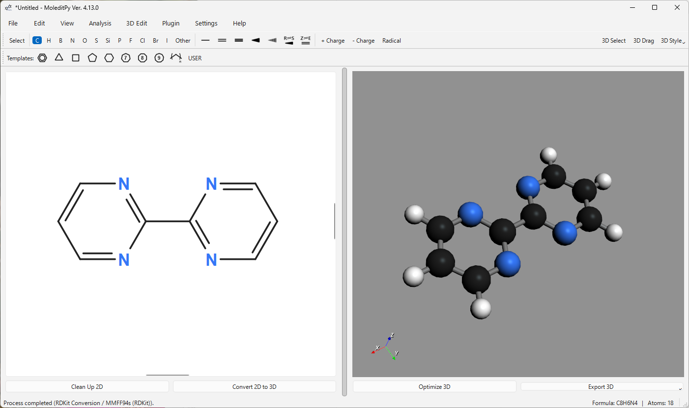

# MoleditPy Windows Installer

## Overview

MoleditPy is a cross-platform, simple, and intuitive molecular editor built in Python.
This installer provides a package built for the Windows environment.

## About This Version

This application bundle is built from the unified `moleditpy` package and uses PySide6-Essentials; Open Babel is not bundled.
Note: As `pip` is not included in this package, plugins requiring external dependencies cannot be executed.

This download is the 5.0.0a1 alpha prerelease.

## Download

Please download the installer from the link below.
The download will start upon clicking.

[Download MoleditPy Windows Installer](https://github.com/HiroYokoyama/python_molecular_editor/releases/download/v5.0.0a1/MoleditPy_5.0.0a1_win64_setup.exe)

A portable version is also available:

[Download MoleditPy Windows Portable](https://github.com/HiroYokoyama/python_molecular_editor/releases/download/v5.0.0a1/MoleditPy_5.0.0a1_win64_portable.zip)

## Installation Steps

1.  **Download**
    Download the setup file (.exe) from the link above.

2.  **Run Installer**
    Double-click the downloaded file to run it.

    *Note: If Windows SmartScreen displays the "unrecognized app" warning, please click "More info" and select "Run anyway" to proceed.*

3.  **Setup**
    The setup wizard will launch. Follow the on-screen instructions and click "Next" to proceed with the installation. You can specify the installation folder if necessary.

4.  **Completion**
    Once the installation is complete, a shortcut will be added to the Start menu.

## Uninstallation

To remove the software, open Windows "Settings" > "Apps" > "Installed apps," select "MoleditPy" from the list, and execute "Uninstall."

## System Requirements

  * **OS**: Windows 10 / 11 (64bit)
  * **Processor**: Modern x64 architecture processor
  * **Memory**: 4GB or more recommended

## Disclaimer

The developer assumes no responsibility for any damages arising from the use of this software. Please use it at your own risk.

